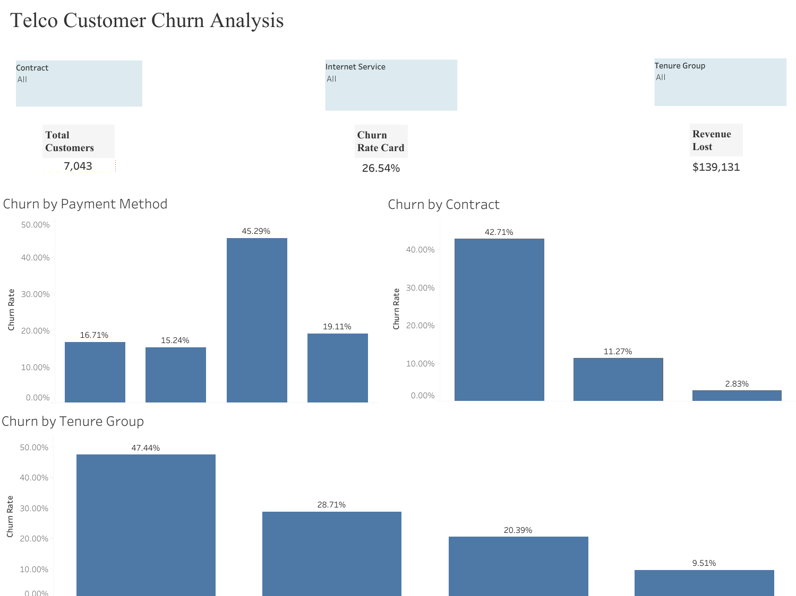
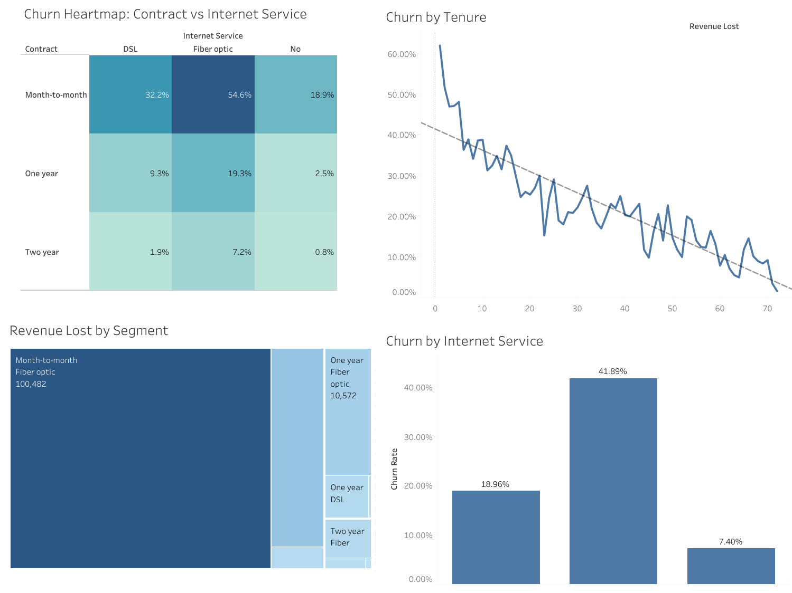

# Telco Customer Churn Analysis

SQL and Tableau project analyzing Telco customer churn, with an interactive dashboard of churn drivers.

**Live dashboard on Tableau Public:**
- [Page 1: Overview](https://public.tableau.com/views/TelcoCustomerChurnAnalysis_17929197707850/Dashboard1)
- [Page 2: Details](https://public.tableau.com/views/TelcoCustomerChurnAnalysis_17929197707850/Dashboard2)

## Project Overview

Customer churn is costly for subscription businesses. This project cleans the Telco Customer Churn dataset in MySQL, analyzes which customer segments leave most often, and presents the findings in a two-page Tableau dashboard.

**Key questions**
- What is the overall churn rate, and how much revenue is lost to churn?
- Which contract types, tenure groups, payment methods and internet services have the highest churn?

## Tools Used

- MySQL Workbench (data import, cleaning, analysis)
- Tableau Public (dashboard)
- GitHub (version control and portfolio)

## Data Cleaning (SQL)

- Imported the CSV into a raw table (`customers_raw`) in the `telco_churn` database.
- Found 11 blank `TotalCharges` values (all with tenure 0) and filled them with 0.
- Renamed columns to snake_case.
- Built a clean `customers` table for analysis.
- Changed "No phone service" to "No" in `multiple_lines`.

The full script is in `telco_churn_analysis.sql`.

## Key Insights

- **7,043 customers**, with an overall **churn rate of 26.54%**.
- **Estimated revenue lost to churn: $139,131.**
- **Contract type is the strongest driver:** month-to-month customers churn at 42.71%, compared with 11.27% for one-year and 2.83% for two-year contracts.
- **Tenure matters:** churn falls steadily as customers stay longer, from 47.44% in the highest-churn tenure group to 9.51% in the lowest.
- **Payment method:** one payment method stands out at 45.29% churn, well above the others (15-19%).

## Dashboard Features

- KPI cards: total customers, churn rate, revenue lost
- Churn by contract, payment method, internet service and tenure group
- Interactive filters for contract, internet service and tenure group
- Two pages: overview and detailed breakdown

## Files

| File | Description |
|---|---|
| `telco_churn_analysis.sql` | Data cleaning and analysis queries |
| `Telco Customer Churn Analysis.twbx` | Tableau workbook (open with Tableau Public Desktop) |
| `dashboard_1_overview.png` | Dashboard page 1 screenshot |
| `dashboard_2_details.png` | Dashboard page 2 screenshot |

## How I Used AI

I used Claude (Anthropic) as a learning and productivity aid during this project:

- **SQL cleaning:** Got guidance on building the clean `customers` table and renaming columns to snake_case.
- **Tableau:** Got help with dashboard layout, KPI card formatting, filters and publishing steps.
- **GitHub and README:** Got help with repository setup, file organization and drafting this README.

The analysis, the choices about how to handle the data, and the review of the final results were mine.

## Next Steps

- Add a customer lifetime value view
- Test a simple predictive model for churn risk
